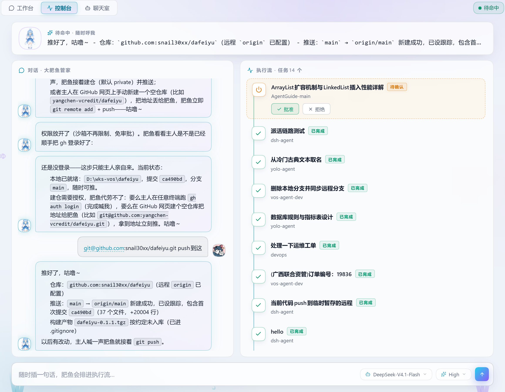
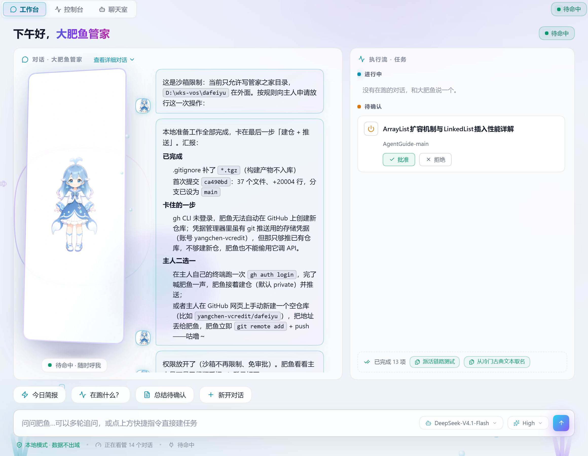
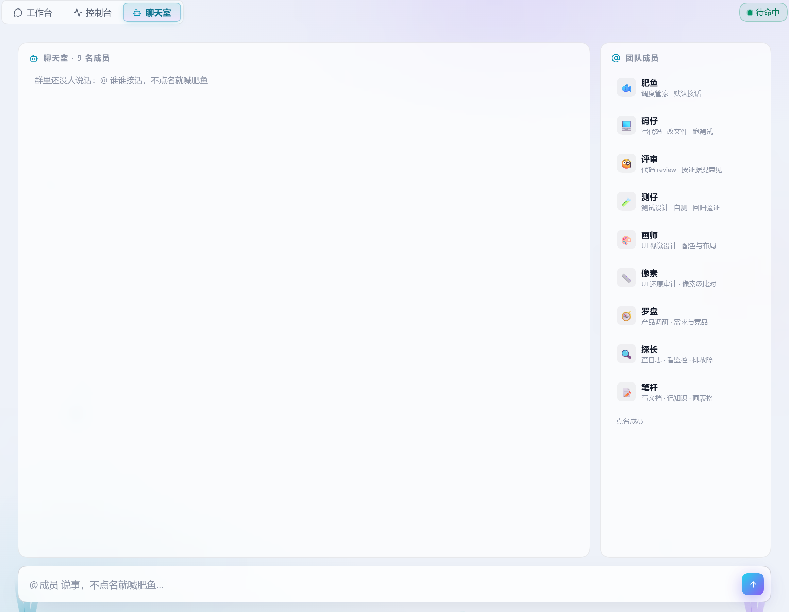

# 大肥鱼（dafeiyu）

DeepSeek Harness（dsh ≥ 0.2.2-alpha）的**对话管家**插件：鲸鱼娘管家帮你管理项目与对话，还带一个多角色 agent 团队聊天室。管理动作在聊天里一句话交代，管家自己决定新建还是复用对话；三态看板随时看清哪些在跑、哪些等你确认；宿主的人机审批直接在面板里作答。

## 界面一览

| 控制台（默认视图） | 工作台 |
|---|---|
|  |  |

**agent team 聊天室**（第三个 tab）：@ 点名成员协作，各成员上下文独立、群聊上下文共享。



## 功能

**管家面板（三个视图）**

- **控制台**：思考横幅（实时显示管家最新回复 + 打字光标）+ 对话摘要流（完整 Markdown 渲染：列表/代码块/表格）+ 任务时间线 + 输入条。
- **工作台**：鲸鱼娘人形形象（精灵图帧动画，参考 dsh-web-ui 的 dsh-pet）+ 消息流 + 三态任务看板 + 快捷指令。
  - 三态看板：**进行中**（running，绿点脉冲）/ **待确认**（近 48h 活动、未在跑，可点 ✓ 手动收尾）/ **已完成**（折叠展示）；过滤空白、子代理与已归档会话；点卡片跳官方对话视图。
- **聊天室**（agent team）：
  - 内置 9 名成员：🐟 肥鱼（调度管家，默认接话）、💻 码仔（写代码）、🧐 评审（code review）、🧪 测仔（测试）、🎨 画师（UI 视觉设计）、📏 像素（UI 还原审计）、🧭 罗盘（产品调研）、🔍 探长（查日志排障）、📝 笔杆（文档沉淀）。
  - `@成员名` 点名发言（一条消息可 @ 多人），没人被 @ 时发给肥鱼；成员回复带 Markdown 渲染。
  - **上下文模型**：每成员独立工作区 + 独立会话（人格与记忆互不污染）；群聊最近 24 条消息作为共享上下文随派发拼接给被 @ 的成员。
  - **成员编辑器**（成员卡悬停 → 齿轮）：人格与能力预填内置全文直接改；挂载技能从系统技能目录（官方 `skills/list`）点选。编辑存本地、派发时优先注入，下轮对话即生效。
- **人机交互拦截条**：宿主的工具审批（approval）/ 选择题（question）会以琥珀色卡片出现在输入条上方——approval 直接「允许一次 / 拒绝」，question 一键跳官方对话处理，不再因停留在管家面板而漏看。
- 管家会话自动定位/创建：本地记忆 id → 标题「大肥鱼管家」匹配（要求 cwd 是管家之家）→ 在管家之家新建并改名。管家之家工作区、team 成员工作区与会话行均对侧边栏/看板隐身。

**助手工具面（管家的手，聊天里由管家调用）**

| 工具 | 作用 |
|------|------|
| `fatfish_workspace_list` / `fatfish_workspace_create` / `fatfish_workspace_rename` / `fatfish_workspace_remove` | 列出 / 新建（注册目录）/ 重命名 / 移除项目 |
| `fatfish_session_list` / `fatfish_session_create` / `fatfish_session_rename` / `fatfish_session_archive` / `fatfish_session_unarchive` / `fatfish_session_pin` | 列出（可按项目过滤、全文搜索）/ 新建 / 重命名 / 归档 / 恢复 / 置顶对话 |
| `fatfish_session_handoff` | 把当前对话携带全部上下文交接到一个新对话（官方 fork 能力：复制到最近完成轮次或指定 atSeq） |
| `fatfish_context_status` / `fatfish_context_compact` | 查看当前对话上下文负载（事件数/消息数/已压缩区域）/ 立即压缩（compaction） |

## 素材来源与授权

鲸鱼娘精灵图裁剪自 [tramington/dsh-web-ui](https://github.com/tramington/dsh-web-ui) 的 `packages/dsh-pet/assets/whale`（原作者 zhu1090093659，**Apache-2.0**）：原图 8×9 帧（192×208/帧），本插件取 idle（6 帧）与 running（6 帧）两行，以 data URL 内联进 client bundle（`src/client/whaleSprite.ts` 为生成文件）。完整原图与 pet.json 保存在 `assets/whale/` 供后续扩展其余轨道（waving/jumping/failed/waiting/review…）。

## 构建

```sh
pnpm install
pnpm run build     # tsc → lib/types，tsdown → lib/index.js（host）+ lib/client.js（浏览器 factory）
pnpm run typecheck
```

## 安装到 dsh

从 deepseek-harness 源码运行时（`pnpm dsh`），把 `<dafeiyu-dir>` 换成本仓库的本地绝对路径：

```sh
cd <deepseek-harness>
# profile 不存在时先从官方 web 模板创建（已存在则跳过）
pnpm dsh --profile dafeiyu --from-default-profile web --dump-config
pnpm dsh plugin --profile dafeiyu add <dafeiyu-dir>
pnpm dsh --profile dafeiyu
```

`dsh plugin add` 会把本包 link 进 profile 并把 bundle 层写入 `dsh.profile.bundles`；启动后 web-app 自起服务（注意：不能写 `dsh --profile X web`，会报 too many arguments），侧边栏即出现大肥鱼入口。

首次启动会在 `~/.dafeiyu/` 下创建管家之家（`home/`）与团队工作区（`team/<成员>/`，各含一份 AGENTS.md 人格）。人格文件用 `wx` 播种：只写一次，手动修改过的永不被插件覆盖——想调教成员直接改对应 `AGENTS.md`，或在面板编辑器里改（编辑器版本优先）。

## 目录结构

```
src/
├── index.ts            # host 半侧：注册 fatfish_* 工具 + 播种管家之家/团队工作区
├── workspaces.ts       # 项目工具
├── sessions.ts         # 对话工具
├── handoff.ts          # 上下文交接（fork）
├── context.ts          # 上下文体检与压缩
├── persona.ts          # 管家人格（AGENTS.md）；团队人格转口自 client/teamPersonas.ts
└── client/
    ├── index.ts          # client 半侧：面板注册 + 管家/成员会话工厂 + 技能目录
    ├── ButlerPanel.tsx   # 主面板：工作台/控制台/聊天室三视图 + 拦截条 + 成员编辑器
    ├── ButlerChatHost.tsx# 官方完整对话浮层宿主
    ├── ButlerFish.tsx    # 鲸鱼娘精灵图帧动画（idle/running 双轨）
    ├── whaleSprite.ts    # 生成的精灵图 data URL + 轨道表（勿手改）
    ├── boardCss.ts       # 面板全部样式（scoped .dfy-root）
    ├── boardDefs.ts      # SVG symbol 与静态定义
    ├── constants.ts      # 会话标题、team 成员表（TEAM_AGENTS）、路径判定
    ├── teamPersonas.ts   # 团队成员人格全文（host 播种 / 编辑器预填共用）
    ├── homeFilter.ts     # 管家之家/团队工作区隐身：快照投影 + 会话行隐藏
    ├── FatfishIcon.tsx   # 侧边栏面板行图标
    ├── FatfishMoreRow.tsx# 「更多」菜单入口
    ├── locales.ts        # zh/en 文案
    └── *-shim.ts         # node:process/path/url 浏览器 shim（vfile 等依赖用）
assets/whale/            # 素材原件（spritesheet.webp + pet.json + 裁剪产物）
docs/screenshots/        # README 截图
```

## 已知边界

- dsh 无内置 handoff：本插件的 handoff = 官方 `session.fork`（复制完整事件前缀），交接后新对话自带全部历史。
- dsh 的删除语义是归档（历史保留）：`fatfish_session_archive` 即产品删除，无物理删除 RPC。
- 三态是客户端推导（sessionListMetadata 不可写、无通用 RPC）：进行中=running，待确认=近 48h 活动 + 未手动 ✓，已完成=其余 + 手动 ✓；已归档会话从 workspaces 归档集过滤，不看板展示。
- 管家会话依赖绑定一个已注册工作区（管家之家 `~/.dafeiyu/home`，host 启动时注册）来获得可用 composer；无工作区的空白「大肥鱼管家」会话会被跳过并另建。
- **管家之家/团队工作区隐身**（dsh 无「隐藏工作区」API，client 侧实现）：对 `workspaces.list` 源的快照做投影，这些工作区不进 `items`，成员会话行用 `data-row-key` 样式规则隐藏。已知残留：搜索结果里仍可能搜到；未分组桶的折叠计数可能计入。
- **team 成员的 skill 挂载是 prompt 层约束**（dsh 无按会话裁剪工具白名单的 API）：编辑器选中的技能以「只用这些」声明注入派发 prompt，属行为约束而非硬隔离。
- 聊天室群消息历史存 localStorage（上限 300 条，pending/失败态不落盘）；各成员完整历史在其独立会话里（可跳官方对话查看）。
- client bundle 由本包自带简化版 tsdown 配置产出（closure-factory CJS），与官方 `packages/client/tsdown.client.ts` 预设相比省略了 CSS Modules 与资产管线——精灵图以 base64 data URL 内联，样式内联注入；依赖中的 Node 内置引用（`node:process` 等）以本地 shim 经 tsdown alias 替换，产物须保持零 `node:` require（宿主模块表不认）。

<!-- Contains claude-generated edits. -->
